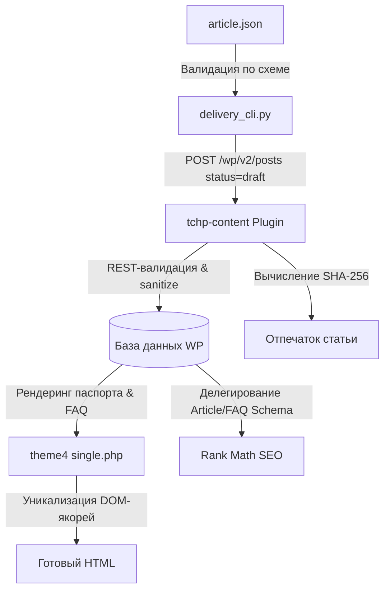

# Раздел 1: Разработка сайта, плагинов и автоматизации

Это руководство предназначено для инженеров и ИИ-ассистентов, вносящих изменения в кодовую базу проекта «Точка Плавления».

Здесь мы создаём и поддерживаем систему: пишем PHP, JavaScript, Python, верстаем тему, развиваем REST API плагина, валидируем схемы и пишем тесты. В этом разделе **не создаются статьи** и **не производятся манипуляции с рабочим контентом**.

---

## 1. Карта репозитория: Актуальные и архивные файлы

### 🟢 Актуальные компоненты (Production & Development):
* [`theme4/`](file:///d:/сайт%20для%20пайки/theme4/) — действующая тема WordPress в стиле Bento-Sketch Hybrid (инженерный блокнот).
* [`wp-content/plugins/tchp-content/`](file:///d:/сайт%20для%20пайки/wp-content/plugins/tchp-content/) — каноническое контентное ядро: инженерные метаполя, строгая REST-валидация, криптографический отпечаток, эндпоинт верификации.
* [`schemas/`](file:///d:/сайт%20для%20пайки/schemas/) — официальные JSON-контракты (`article-contract-v1.schema.json`) и канонические примеры.
* [`tools/`](file:///d:/сайт%20для%20пайки/tools/) — сервисные утилиты:
  * `delivery_cli.py` — безопасная доставка черновиков в WordPress с read-after-write проверкой.
  * `test_live_wp_integration.py` — интеграционный тест-раннер для живого WordPress.
  * `build_distribution_archives.py` — сборщик релизных ZIP-архивов.
  * `ai_article_generator.py` / `generate_article_cli.py` — генератор черновиков на базе Gemini.
* [`tests/`](file:///d:/сайт%20для%20пайки/tests/) — консольный тестовый конвейер:
  * `run-all-tests.py` — единый раннер для локального прогона и CI/CD.
  * `test-package-a1.php` — набор тестов бизнес-логики и контрактов REST API (38 assertions).

### 🟡 Архивные директории (Reference & History):
Папки `theme/`, `theme2/`, `theme3/`, `site/`, `site2/` являются **историческими прототипами**. Они сохранены исключительно как архитектурный архив и источник отдельных статических ассетов. Никакой новый продакшн-код в них не добавляется.

---

## 2. Разделение ответственности компонентов



1. **Плагин `tchp-content`:**
   * Регистрирует инженерные метаполя: `tchp_content_id`, `tchp_solder_alloy`, `tchp_temp_kind`, `tchp_temp_range`, `tchp_temp_peak`, `tchp_tools`, `tchp_faq_items`, `tchp_sources`, `tchp_standard`.
   * Защищает базу данных от пустых значений и скрытых тегов (`wp_strip_all_tags`).
   * Защищает от молчаливой очистки существующих данных при частичных PATCH-обновлениях (`rest_pre_insert_post`).
   * Рассчитывает SHA-256 отпечаток контента и предоставляет защищённый эндпоинт `POST /wp-json/tchp/v1/posts/{id}/verify` с параметром `expected_hash`.
   * Сбрасывает статус верификации в `in_review` (`outdated=1`) при любом изменении проверенного текста.

2. **Тема `theme4`:**
   * Отвечает строго за визуальное представление и пользовательский опыт.
   * Рендерит технический паспорт статьи, интерактивную температурную плашку, структурированные инструменты и аккордеон FAQ.
   * Запускает канонический DOM-резолвер `tchp_process_article_anchors()` в `includes/functions.php`: разрешает коллизии любых тегов с ID и строит чистое оглавление.
   * Делегирует Schema.org плагину Rank Math при активном модуле rich-snippets.

3. **Плагин Rank Math SEO:**
   * Формирует граф Schema.org (`Article`, `FAQPage`, `BreadcrumbList`).
   * Тема проверяет активность сниппетов Rank Math и подавляет собственный дублирующий микровывод JSON-LD во избежание конфликтов поисковых краулеров.

4. **Движок доставки `tools/delivery_cli.py`:**
   * Валидирует входящий файл по `article-contract-v1.schema.json`.
   * Разрешает рубрики и теги в реальные числовые ID WordPress.
   * Работает strictly в режиме `draft` / `pending` (публикация запрещена).
   * Защищает опубликованные статьи от перезаписи (флаг `--force` удалён).
   * Проводит побайтовую сверку *read-after-write* и ведёт атомарный журнал `delivery-journal.json`.

---

## 3. Регламент тестирования

Перед каждым коммитом в репозиторий выполняется локальный Quality Gate:

### 1. Запуск полного локального набора тестов:
```bash
python tests/run-all-tests.py --build
```
Раннер последовательно выполняет:
* Валидацию JSON Schema Draft-07 и соответствия канонического примера.
* Проверку синтаксиса PHP (`php -l`) всех файлов плагина и темы.
* 9 сценариев бизнес-логики и контрактов REST API (38 assertions на mock-окружении).
* Сборку релизных ZIP-архивов и их побайтовую сверку с исходным кодом.

### 2. Проверка существующих архивов без пересборки:
```bash
python tests/run-all-tests.py --verify-only
```
Сверяет все 177 файлов темы `theme4.zip` и файл плагина `tchp-content.zip` на 100% совпадение с рабочей директорией (отсутствие лишних или пропущенных файлов).

### 3. Интеграционное тестирование на живом WordPress (Этап Б.0):
```bash
python tools/test_live_wp_integration.py --wp-url "https://test.tochka-plavleniya.ru" --wp-user "automation" --wp-pass "xxxx" --editor-user "editor" --editor-pass "yyyy"
```
*Запускается на тестовом стенде WordPress.* Проверяет реальную базу данных MySQL, создание черновика, валидацию пустых HTML-тегов, глубокое сохранение полей, права редактора vs автора и блокировку устаревшего `expected_hash` (строго `409 Conflict`).

---

## 4. Сборка дистрибутивов и обновление сайта

### Сборка ZIP-пакетов:
```bash
python tools/build_distribution_archives.py
```
Скрипт формирует:
* `theme4.zip` (корень внутри архива: `theme4/`)
* `tchp-content.zip` (корень внутри архива: `tchp-content/`)

*Оба архива собираются со стандартизированными POSIX-путями (прямые слэши `/`), что гарантирует корректную распаковку на Linux-серверах.*

### Процедура безопасного обновления на сервере:
1. Создать резервную копию базы данных и каталога `wp-content/`.
2. Загрузить `tchp-content.zip` через панель администрирования (*Плагины → Добавить новый → Загрузить*) или распаковать в `wp-content/plugins/`.
3. Загрузить `theme4.zip` через *Внешний вид → Темы*.
4. Проверить доступность REST API: `GET /wp-json/tchp/v1/health` или `GET /wp-json/wp/v2/posts`.
5. В случае ошибок восстановить предыдущую версию из резервной копии.

---

## 5. Статус Пакета Б: Открытые задачи

Локальная mock-логика и контракты полностью покрыты тестами (**38/38 PASS**). Однако Пакет Б считается принятым **только после выполнения интеграционных тестов на настоящем WordPress**:

- [x] Строгая валидация по схеме `article-contract-v1.schema.json`.
- [x] Побайтовое совпадение SHA-256 отпечатка между PHP и Python.
- [x] Разрешение таксономий (`category_slug`, `tags`) в числовые ID.
- [x] Защита от перезаписи опубликованных постов и контроль ручных правок.
- [x] Атомарный журнал доставок с защитой от параллельных запусков.
- [x] Полноценный read-after-write с ненулевым кодом выхода при расхождениях.
- [ ] **Открытая задача:** Запуск `tools/test_live_wp_integration.py` на реальном стенде WordPress с базой данных MySQL и подтверждение чистого прогона.

---

## 6. Используемые AI-скиллы

При работе в Разделе 1 используются:
* `build-partner` — для самообучения, анализа замечаний и автоматического обновления правил репозитория.
* `ui-ux-pro-max` / `ui-styling` — для проектирования компонентов строго в рамках дизайн-системы Bento-Sketch Hybrid (без неоновых градиентов, эмодзи и AI-палитр).

**Результат работы в Разделе 1:** Проверенный код, успешный прогон тестов, валидные дистрибутивы и детальный отчёт о diff. Не создание статей!
