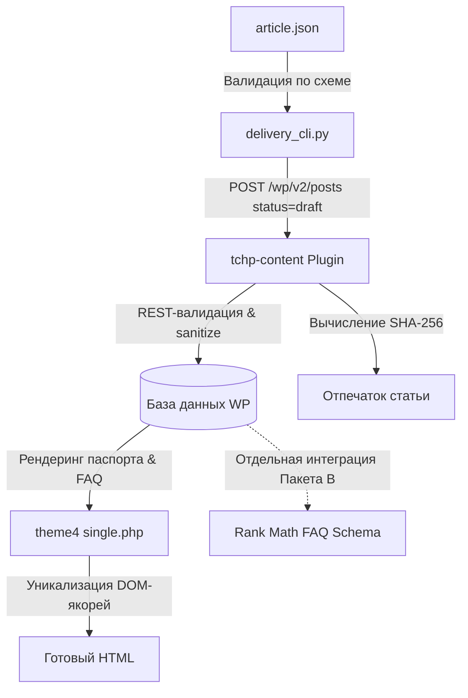

# Раздел 1: Разработка сайта, плагинов и автоматизации

Это руководство предназначено для инженеров и ИИ-ассистентов, вносящих изменения в кодовую базу проекта «Точка Плавления».

Здесь мы создаём и поддерживаем систему: пишем PHP, JavaScript, Python, верстаем тему, развиваем REST API плагина, валидируем схемы и пишем тесты. В этом разделе **не создаются статьи** и **не производятся манипуляции с рабочим контентом**.

---

## 1. Карта репозитория: Актуальные и архивные файлы

### 🟢 Актуальные компоненты (Production & Development):
* [`theme4/`](../../theme4/) — действующая тема WordPress в стиле Bento-Sketch Hybrid (инженерный блокнот).
* [`wp-content/plugins/tchp-content/`](../../wp-content/plugins/tchp-content/) — каноническое контентное ядро: инженерные метаполя, строгая REST-валидация, криптографический отпечаток, эндпоинт верификации.
* [`schemas/`](../../schemas/) — официальные JSON-контракты (`article-contract-v1.schema.json`) и канонические примеры.
* [`tools/`](../../tools/) — сервисные утилиты:
  * `delivery_cli.py` — безопасная доставка черновиков в WordPress с read-after-write проверкой.
  * `test_live_wp_integration.py` — интеграционный тест-раннер для живого WordPress.
  * `build_distribution_archives.py` — сборщик релизных ZIP-архивов.
  * `ai_article_generator.py` / `generate_article_cli.py` — генератор черновиков на базе Gemini.
* [`tests/`](../../tests/) — консольный тестовый конвейер:
  * `run-all-tests.py` — единый раннер для локального прогона и CI/CD.
  * `test-package-a1.php` — набор тестов бизнес-логики и контрактов REST API (10 сценариев, 43 assertions).
  * `test_delivery_cli_unit.py` — модульные тесты канонизации отпечатка, журнала и глубокой сверки (6 тестов).

### 🟡 Архивные директории (Reference & History):
Папки `theme/`, `theme2/`, `theme3/`, `site/`, `site2/` являются **историческими прототипами**. Они сохранены исключительно как архитектурный архив и источник отдельных статических ассетов. Никакой новый продакшн-код в них не добавляется.

---

## 2. Разделение ответственности компонентов



1. **Плагин `tchp-content`:**
   * Регистрирует инженерные метаполя: `tchp_content_id`, `tchp_solder_alloy`, `tchp_temp_kind`, `tchp_temp_range`, `tchp_temp_peak`, `tchp_tools`, `tchp_faq_items`, `tchp_sources`, `tchp_standard`.
   * Защищает базу данных от пустых значений и скрытых тегов (`wp_strip_all_tags`).
   * Защищает от молчаливой очистки существующих данных при частичных PATCH-обновлениях (`rest_pre_insert_post`).
   * Рассчитывает канонический SHA-256 отпечаток контента и предоставляет защищённый эндпоинт `POST /wp-json/tchp/v1/posts/{id}/verify` с параметром `expected_hash`.
   * Сбрасывает статус верификации в `in_review` (`outdated=1`) при любом изменении проверенного текста.

2. **Тема `theme4`:**
   * Отвечает строго за визуальное представление и пользовательский опыт.
   * Рендерит технический паспорт статьи, интерактивную температурную плашку, структурированные инструменты и аккордеон FAQ.
   * Запускает канонический DOM-резолвер `tchp_process_article_anchors()` в `includes/functions.php`: разрешает коллизии любых тегов с ID и строит чистое оглавление.
   * Подавляет дублирующие базовые схемы при наличии активного SEO-плагина.

3. **Плагин Rank Math SEO:**
   * Формирует граф Schema.org (`Article`, `BreadcrumbList`).
   * **Важно по FAQ:** Произвольные метаполя `tchp_faq_items` не преобразуются Rank Math в схему `FAQPage` автоматически «из коробки». Для этого требуется отдельный фильтр `rank_math/json_ld` (задача интеграции Пакета В).

4. **Движок доставки `tools/delivery_cli.py`:**
   * Валидирует входящий файл по `article-contract-v1.schema.json`.
   * Разрешает рубрики и теги в реальные числовые ID WordPress (при сбое API — аварийный останов, без отбрасывания таксономий).
   * Работает strictly в режиме `draft` / `pending` (публикация запрещена).
   * Защищает опубликованные статьи от перезаписи (флаг `--force` удалён).
   * При сетевых обрывах и 5xx фиксирует статус `outcome_unknown`, блокируя повторное создание дубликатов.
   * Проводит глубокую сверку *read-after-write* (`content.raw`, `status`, `slug`, `categories`, `tags`, метаполя) и ведёт атомарный версионированный журнал `delivery-journal.json`.

---

## 3. Регламент тестирования

Перед каждым коммитом в репозиторий выполняется локальный Quality Gate:

### 1. Запуск полного локального набора тестов:
```bash
python tests/run-all-tests.py --build
```
Раннер последовательно выполняет:
* Валидацию JSON Schema Draft-07 и соответствия канонического примера.
* Проверку синтаксиса PHP (`php -l`) всех файлов плагина и темы.
* 10 сценариев бизнес-логики и контрактов REST API (43 assertions на mock-окружении, включая канонизацию отпечатков).
* 6 модульных проверок CLI-доставки (`test_delivery_cli_unit.py`).
* Сборку релизных ZIP-архивов и их побайтовую сверку с исходным кодом.

### 2. Проверка существующих архивов без пересборки:
```bash
python tests/run-all-tests.py --verify-only
```
Сверяет все файлы темы `theme4.zip` и плагина `tchp-content.zip` на 100% совпадение с рабочей директорией.

### 3. Интеграционное тестирование на живом WordPress (Этап Б.0):
```bash
python tools/test_live_wp_integration.py --wp-url "https://test.tochka-plavleniya.ru" --wp-user "automation" --wp-pass "xxxx" --editor-user "editor" --editor-pass "yyyy"
```
*Запускается на тестовом стенде WordPress.* Проверяет реальную базу данных MySQL, создание черновика, валидацию пустых HTML-тегов, глубокое сохранение полей, права редактора vs автора, запрет прямой публикации автоматизацией, исполнение `delivery_cli.py` как подпроцесса, реакцию на ручные правки (код 3) и подтверждение удаления тестовых записей (GET 404).

---

## 4. Сборка дистрибутивов и обновление сайта

### Сборка ZIP-пакетов:
```bash
python tools/build_distribution_archives.py
```
Скрипт формирует:
* `theme4.zip` (корень внутри архива: `theme4/`)
* `tchp-content.zip` (корень внутри архива: `tchp-content/`)

*Оба архива собираются со стандартизированными POSIX-путями (прямые слэши `/`), что гарантирует корректную распаковку на Linux-серверах.*

### Процедура безопасного обновления на сервере:
1. Создать резервную копию базы данных и каталога `wp-content/`.
2. Загрузить `tchp-content.zip` через панель администрирования (*Плагины → Добавить новый → Загрузить*) или распаковать в `wp-content/plugins/`.
3. Загрузить `theme4.zip` через *Внешний вид → Темы*.
4. Проверить доступность REST API: `GET /wp-json/wp/v2/posts`.
5. В случае ошибок восстановить предыдущую версию из резервной копии.

---

## 5. Статус Пакета Б: Текущее состояние компонентов

В соответствии с правилами приёмки проекта, статус каждого компонента фиксируется по факту конкретных проверок:

| Компонент / Механизм | Реализация в коде | Локальная проверка | Стенд (Live WordPress) |
|---|---|---|---|
| **Валидация по схеме `article-contract-v1.schema.json`** | Реализовано (`tools/delivery_cli.py`) | Проверено: Draft-07 validator PASS в `run-all-tests.py` | Ожидает проверки на стенде |
| **Канонический отпечаток SHA-256 (паритет PHP/Python)** | Реализовано (`tchp-content.php`, `delivery_cli.py`) | Проверено: Сценарий 10 в `test-package-a1.php` (байтовое совпадение с эталоном), `test_delivery_cli_unit.py` | Ожидает проверки на стенде |
| **Строгое разрешение таксономий (рубрики и теги)** | Реализовано (`resolve_category`, `resolve_tag`) | Проверено: `test_delivery_cli_unit.py` (останов при ошибках) | Ожидает проверки на стенде |
| **Защита от перезаписи опубликованных постов и ручных правок** | Реализовано (`send_draft_command`) | Проверено: `test_delivery_cli_unit.py` (код выхода 3) | Ожидает проверки на стенде |
| **Обработка неопределённых сетевых исходов (5xx, потеря связи)** | Реализовано (`status: outcome_unknown`) | Проверено: `test_delivery_cli_unit.py` | Ожидает проверки на стенде |
| **Атомарный журнал v2.0 с блокировкой 0-байтных файлов** | Реализовано (`DeliveryJournal`) | Проверено: `test_delivery_cli_unit.py` (отказ на пустом файле) | Ожидает проверки на стенде |
| **Глубокий read-after-write (`content.raw`, `status`, `slug`, `meta`)** | Реализовано (`verify_read_back`) | Проверено: `test_delivery_cli_unit.py` (сверка 11 скаляров и 3 массивов) | Ожидает проверки на стенде |
| **Интеграционный тест-раннер живого стенда** | Реализовано (`tools/test_live_wp_integration.py`) | Проверено: синтаксис и структура CLI | **Не проверено** (ожидает запуска на реальном WordPress с MySQL) |

> [!IMPORTANT]
> Пакет Б считается принятым **только после успешного запуска `test_live_wp_integration.py` на реальном стенде WordPress** и подтверждения всеми ассертами реальной записи в базу данных MySQL.
