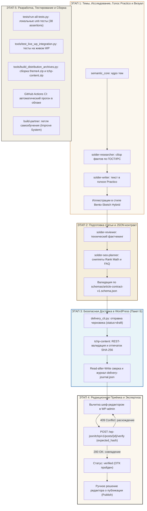

# 🔗 Карта Сквозного Процесса «Точка Плавления» (Master Pipeline Map)

Этот документ представляет собой обзорную карту сквозного конвейера проекта: от формирования темы до доставки черновика в WordPress, редакционной вычитки и тестирования.

Детальные пошаговые руководства вынесены в специализированные разделы. Полный навигатор доступен в [START_HERE.md](file:///d:/сайт%20для%20пайки/docs/START_HERE.md).

---

## 🗺️ Генеральная Архитектурная Схема Конвейера

---

## 🧭 Навигация по 4 руководствам системы

### 1. [Раздел 1: Разработка сайта, плагинов и автоматизации](file:///d:/сайт%20для%20пайки/docs/01-development/GUIDE.md)
* **Для чего:** Разработка PHP-кода темы `theme4` и плагина `tchp-content`, доработка CLI-скриптов доставки, поддержка схем контрактов.
* **Ключевые инструменты:** `tests/run-all-tests.py`, `tools/delivery_cli.py`, `tools/test_live_wp_integration.py`, `tools/build_distribution_archives.py`.
* **Результат работы:** Протестированный код, 38/38 unit-тестов, валидные ZIP-дистрибутивы с побайтовой сверкой.

### 2. [Раздел 2: Установка и настройка WordPress](file:///d:/сайт%20для%20пайки/docs/02-wordpress-setup/GUIDE.md)
* **Для чего:** Пошаговая инструкция по настройке хостинга, постоянных ссылок, рубрик, пользователей и паролей приложений (Application Passwords).
* **Таблица плагинов:** `tchp-content`, Rank Math SEO, кэширование, бэкапы.
* **Результат работы:** Проверенный и защищённый стенд WordPress, готовый принимать черновики через REST API.

### 3. [Раздел 3: Подготовка и публикация статьи](file:///d:/сайт%20для%20пайки/docs/03-editorial-publishing/GUIDE.md)
* **Для чего:** Выбор типа статьи, заполнение полей JSON-контракта, каталог контентных паттернов (TL;DR, Warning, Steps, Troubleshooting, FAQ), безопасная отправка черновика и подтверждение верификации `expected_hash`.
* **Ключевой контракт:** [`schemas/article-contract-v1.schema.json`](file:///d:/сайт%20для%20пайки/schemas/article-contract-v1.schema.json).
* **Результат работы:** Валидированный черновик в WordPress со статусом `verified`.

### 4. [Раздел 4: Темы, исследование, ваш голос и изображения](file:///d:/сайт%20для%20пайки/docs/04-research-voice-visuals/GUIDE.md)
* **Для чего:** Отбор тем из семантического ядра, сбор доказательной базы по ГОСТ/IPC, написание текста в авторском голосе Practico и генерация иллюстраций в стиле Bento-Sketch Hybrid.
* **Главные инварианты:** Запрет выдуманного опыта, формула *«термин → механизм → последствие»*, карандашная графика на бумажном фоне `#FBF7EE`.
* **Результат работы:** Готовый текст статьи и проверенные схемы.

---

## 🏛️ Единые источники истины проекта

| Ресурс | Файл источника |
|---|---|
| **JSON-контракт статьи** | [`schemas/article-contract-v1.schema.json`](file:///d:/сайт%20для%20пайки/schemas/article-contract-v1.schema.json) |
| **Канонический пример статьи** | [`schemas/article-example-v1.json`](file:///d:/сайт%20для%20пайки/schemas/article-example-v1.json) |
| **Реестр припоев и сплавов** | Функция `tchp_get_canonical_alloys()` в [`tchp-content.php`](file:///d:/сайт%20для%20пайки/wp-content/plugins/tchp-content/tchp-content.php) |
| **Редакционная верификация** | Метаполя и SHA-256 в [`tchp-content.php`](file:///d:/сайт%20для%20пайки/wp-content/plugins/tchp-content/tchp-content.php) |
| **Визуальная система** | Токены темы [`theme4/`](file:///d:/сайт%20для%20пайки/theme4/) и правила [`DESIGN.md`](file:///d:/сайт%20для%20пайки/DESIGN.md) |
