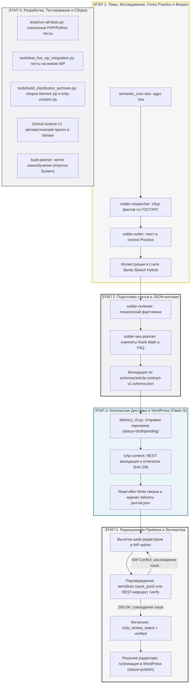

# 🔗 Карта Сквозного Процесса «Точка Плавления» (Master Pipeline Map)

Этот документ представляет собой обзорную карту сквозного конвейера проекта: от формирования темы до доставки черновика в WordPress, редакционной вычитки и тестирования.

Детальные пошаговые руководства вынесены в специализированные разделы. Полный навигатор доступен в [START_HERE.md](START_HERE.md).

---

## 🗺️ Генеральная Архитектурная Схема Конвейера

---

## 🧭 Навигация по 4 руководствам системы

### 1. [Раздел 1: Разработка сайта, плагинов и автоматизации](01-development/GUIDE.md)
* **Для чего:** Разработка PHP-кода темы `theme4` и плагина `tchp-content`, доработка CLI-скриптов доставки, поддержка схем контрактов.
* **Ключевые инструменты:** `tests/run-all-tests.py`, `tests/test_delivery_cli_unit.py`, `tools/delivery_cli.py`, `tools/test_live_wp_integration.py`, `tools/build_distribution_archives.py`.
* **Результат работы:** Протестированный код, локальные тесты (PHP 43/43, Python 6/6), валидные ZIP-дистрибутивы с побайтовой сверкой.

### 2. [Раздел 2: Установка и настройка WordPress](02-wordpress-setup/GUIDE.md)
* **Для чего:** Пошаговая инструкция по настройке хостинга, Nginx-конфигурации, постоянных ссылок, рубрик, пользователей и паролей приложений (Application Passwords).
* **Таблица плагинов:** `tchp-content`, Rank Math SEO, кэширование, бэкапы.
* **Результат работы:** Проверенный и защищённый стенд WordPress, готовый принимать черновики через REST API.

### 3. [Раздел 3: Подготовка и публикация статьи](03-editorial-publishing/GUIDE.md)
* **Для чего:** Выбор типа статьи, заполнение полей JSON-контракта, каталог контентных паттернов (TL;DR, Warning, Steps, Troubleshooting, FAQ), безопасная отправка черновика и подтверждение верификации `expected_hash`.
* **Ключевой контракт:** [`schemas/article-contract-v1.schema.json`](../schemas/article-contract-v1.schema.json).
* **Результат работы:** Валидированный черновик в WordPress с подтверждённым метаполем `tchp_review_status = verified`.

### 4. [Раздел 4: Темы, исследование, ваш голос и изображения](04-research-voice-visuals/GUIDE.md)
* **Для чего:** Отбор тем из семантического ядра, сбор доказательной базы по ГОСТ/IPC, написание текста в авторском голосе Practico и генерация иллюстраций в стиле Bento-Sketch Hybrid.
* **Главные инварианты:** Запрет выдуманного опыта, формула *«термин → механизм → последствие»*, графика на бумажном фоне `#F6F6F6` (светлая) / `#121212` (тёмная) с акцентом `#FFC700`.
* **Результат работы:** Готовый текст статьи и проверенные схемы.

---

## 🏛️ Единые источники истины проекта

| Ресурс | Назначение | Файл источника |
|---|---|---|
| **JSON-контракт статьи** | Обязательные поля, типы данных, ограничения | [`schemas/article-contract-v1.schema.json`](../schemas/article-contract-v1.schema.json) |
| **Канонический пример статьи** | Эталон структуры данных для валидации | [`schemas/article-example-v1.json`](../schemas/article-example-v1.json) |
| **Физические свойства припоев** | Справочник `$MATERIALS_REGISTRY`: солидус, ликвидус, состав, ГОСТ | [`theme4/data/materials-registry.php`](../theme4/data/materials-registry.php) |
| **Разрешённые ID сплавов** | Список канонических слагов и нормализация (`tchp_get_canonical_alloys`) | [`wp-content/plugins/tchp-content/tchp-content.php`](../wp-content/plugins/tchp-content/tchp-content.php) |
| **Редакционная верификация** | Метаполя ОТК и серверный расчёт отпечатка SHA-256 | [`wp-content/plugins/tchp-content/tchp-content.php`](../wp-content/plugins/tchp-content/tchp-content.php) |
| **Дизайн-токены и стиль** | Палитра (`#f6f6f6`, `#FFC700`, `#121212`), шрифты, сетка, радиусы | [`theme4/assets/css/tokens.css`](../theme4/assets/css/tokens.css) и [`DESIGN.md`](../DESIGN.md) |
| **Семантическое ядро** | Темы, кластеры, поисковые интенты | рабочая база [`seo/data/seo.db`](../seo/data/seo.db); исходный импорт — `semantic_core_FULL_v11.xlsx` (архивирован) |
