# 🔗 Генеральный Сквозной Конвейер Проекта «Точка Плавления» (Master Pipeline)

Единая сквозная цепочка всех процессов проекта: от выбора темы из семантического ядра до публикации, проверки целостности, автоматического тестирования, CI/CD и самообучения системы.

---

## 🗺️ Генеральная Архитектурная Схема

```mermaid
graph TD
    subgraph Phase1["ФАЗА 1: Инженерно-контентный конвейер (AI Gems & Skills)"]
        A[semantic_core: ядро тем] --> B[solder-researcher: анализ интента и рисков]
        B --> C[solder-writer: написание статьи Habr-like]
        C --> D[solder-reviewer: аудит, фактчекинг и стоп-слова]
        D --> E[solder-seo-planner: сниппеты Rank Math и FAQ Schema]
    end

    subgraph Phase2["ФАЗА 2: Доставка и Редакционная Верификация (WordPress & tchp-content)"]
        E --> F[solder-wordpress-publisher: сборка JSON-пейлоада]
        F --> G["POST /wp-json/wp/v2/posts (status=draft)"]
        G --> H["tchp-content: валидация схемы (сплавы, minLength, pattern)"]
        H --> I["Расчёт SHA-256 отпечатка статьи"]
        I --> J["Вычитка шеф-редактором в админке WP"]
        J --> K["POST /wp-json/tchp/v1/posts/{id}/verify (expected_hash)"]
        K -->|409 Conflict: расхождение| J
        K -->|200 OK: совпадение| L["Статус: verified (5/5 критериев выполнено)"]
    end

    subgraph Phase3["ФАЗА 3: Презентация и Вёрстка (theme4 Frontend)"]
        L --> M["theme4 (single.php): рендеринг статьи"]
        M --> N["Двухпроходный фильтр: 100% уникальность DOM-якорей"]
        N --> O["Rank Math: делегирование Schema.org Article/FAQ"]
        O --> P["Bento-Sketch Hybrid: адаптив 375 / 768 / 1024 / 1440 px"]
    end

    subgraph Phase4["ФАЗА 4: Quality Gate, CI/CD и Самообучение (DevOps & Build Partner)"]
        P --> Q["tests/run-all-tests.py: 34 автоматических unit-теста"]
        Q --> R["tools/build_distribution_archives.py: сборка theme4.zip и tchp-content.zip"]
        R --> S["git push origin main"]
        S --> T["GitHub Actions CI: автоматический прогон в облаке"]
        T --> U["build-partner: Improve System (анализ замечаний и генерация новых правил)"]
    end

    style Phase1 fill:#fbf7ee,stroke:#d4a373,stroke-width:2px
    style Phase2 fill:#f5eedc,stroke:#8c6d46,stroke-width:2px
    style Phase3 fill:#fbf7ee,stroke:#2d2b28,stroke-width:2px
    style Phase4 fill:#e8f4f8,stroke:#2b6cb0,stroke-width:2px
```



---

## 🧭 Пошаговый Регламент Выполнения Цепочки

### ФАЗА 1: Инженерно-контентный конвейер
1. **Отбор темы (`solder-researcher`):**
   - Выбирается тема из файла `semantic_core - статьи.csv` (листы `content_plan`, `clusters`, `competitors`).
   - Формируется бриф: реальный интент читателя, пробелы конкурентов, обязательные риски безопасности (свинец, вытяжка, термоудар), скелет H2/H3 и вопросы для FAQ.
2. **Создание инженерного текста (`solder-writer`):**
   - Текст пишется строго в Habr-like тоне: без вводной воды, штампов («ни для кого не секрет») и кулинарных метафор.
   - Обязательно указываются канонический сплав (`pos61`, `sac305` и др.) и стартовые температуры жала в °C.
3. **Технический фактчекинг (`solder-reviewer`):**
   - Проверка соответствия температур ликвидусу и теплоёмкости плат.
   - Фильтрация по словарю стоп-слов (`04_forbidden_phrases.txt`).
   - Проверка честности обещаний: никаких симуляций «QC PASSED», виджеты называются строго по регламенту.
4. **Семантическая оптимизация (`solder-seo-planner`):**
   - Подготовка заголовка `Title` (до 60 знаков) и `Meta Description` (до 160 знаков).
   - Формирование структурированных пар FAQ для сниппетов поисковиков.
   - Проверка готовности текста к извлечению прямых ответов ИИ-краулерами (LLMS.txt).

---

### ФАЗА 2: Доставка и Редакционная Верификация
5. **Формирование REST-пейлоада (`solder-wordpress-publisher`):**
   - Заполняются метаполя плагина `tchp-content`: `tchp_solder_alloy`, `tchp_temp_min`, `tchp_temp_max`, `tchp_difficulty`, массивы `tchp_tools`, `tchp_faq_items`, `tchp_sources`.
   - **Жёсткое правило:** Статус публикации строго `draft` или `pending`. Авто-публикация запрещена.
6. **Защищённая запись через REST API:**
   - Плагин `tchp-content` проверяет валидность типов (`minLength: 1`, `pattern: '\S'`).
   - Хук `rest_pre_insert_post` блокирует случайное затирание существующих полей при частичных апдейтах.
   - Сервер вычисляет канонический SHA-256 отпечаток (`fingerprint`).
7. **Экспертная приёмка шеф-редактором:**
   - Человек-редактор проверяет статью в панели управления WordPress.
   - Нажатие кнопки «Подтвердить редакцию» отправляет запрос `POST /wp-json/tchp/v1/posts/{id}/verify` с параметром `expected_hash`.
   - Если за время вычитки данные изменились — сервер вернёт **409 Conflict**.
   - Если хеш совпал — сервер возвращает **200 OK** и присваивает статус `verified` (с записью `verified_by` и `verified_at`). Любое последующее редактирование статьи автоматически сбрасывает статус в `in_review` (`stale = true`).

---

### ФАЗА 3: Презентация и Вёрстка
8. **Рендеринг статьи в теме `theme4` (`single.php`):**
   - Вывод паспорта статьи с интерактивной плашкой температуры и сплава.
   - Вывод структурированных инструментов и аккордеона FAQ из метаполей.
9. **Двухпроходная уникализация DOM-якорей:**
   - Парсер DOM темы сканирует все заголовки H2-H4, генерирует читаемые транслит-якоря и гарантирует отсутствие дублей с системными секциями (`sec-tools`, `sec-faq`, `sec-sources`).
10. **SEO-делегирование и Адаптив:**
    - Тема проверяет модуль Rank Math Rich Snippet и уступает генерацию Schema.org плагину SEO.
    - Вёрстка в стиле Bento-Sketch Hybrid (бумажный фон, карандашный контур 1px, монохромный вектор SVG) идеально адаптируется под экраны **375px**, **768px**, **1024px** и **1440px**.

---

### ФАЗА 4: Quality Gate, CI/CD и Самообучение
11. **Локальный Quality Gate:**
    - Запуск консольного раннера:
      ```bash
      python tests/run-all-tests.py
      ```
    - Проверяется валидность JSON-схем, синтаксис PHP, все 9 сценариев интеграционных тестов (34 assertions) и структура ZIP-архивов.
12. **Сборка релизных дистрибутивов:**
    - `python tools/build_distribution_archives.py` упаковывает свежие `theme4.zip` и `tchp-content.zip` с POSIX-путями для Linux-хостинга.
13. **Контроль версий и GitHub Actions CI:**
    - Коммит и пуш в ветку `main` отправляются на GitHub.
    - Облачный конвейер `.github/workflows/ci.yml` запускает тесты на чистом окружении Ubuntu (PHP 8.2 + Python 3.12) и публикует релизные архивы в артефакты сборки.
14. **Петля самообучения (`build-partner`):**
    - Если в процессе ревью возникли новые требования, замечания или не учтённые нюансы — скилл `build-partner` (`Improve System`) анализирует логи, извлекает правила и автоматически обновляет стандарты репозитория, предотвращая повторение ошибок.

---

## 🏆 Результат работы конвейера

Каждая единица контента и кода, прошедшая этот конвейер:
- На 100% соответствует физическим и техническим стандартам пайки.
- Защищена криптографическим отпечатком от рассинхронизации правок.
- Корректно индексируется как традиционными поисковиками, так и ИИ-системами.
- Полностью покрыта тестами и автоматически верифицируется в GitHub Actions CI.
