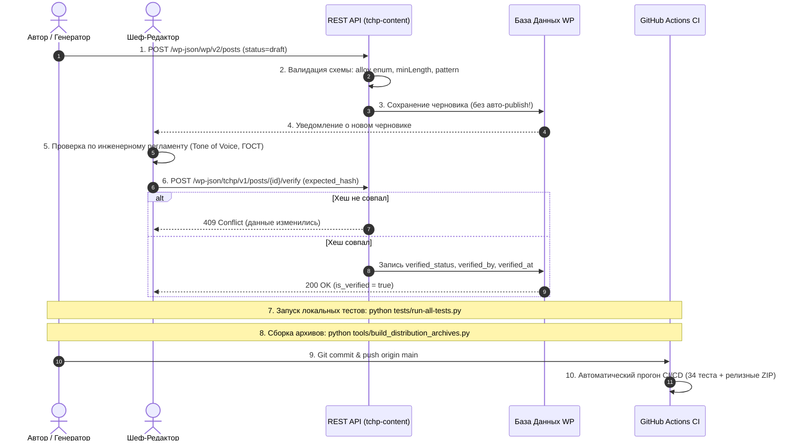

# База Знаний и Сводный Манифест Проекта «Точка Плавления»

> [!NOTE]
> **Исторический манифест (Архивный контекст проекта)**
> Этот документ фиксирует историю проектных обсуждений и концептуальный базис.
> **Актуальная рабочая документация, архитектурные контракты и действующие руководства размещены в директории [`docs/`](START_HERE.md):**
> * [Стартовый навигатор проекта](START_HERE.md)
> * [Сквозная карта конвейера](MASTER_PIPELINE.md)
> * [Раздел 1: Разработка и тестирование](01-development/GUIDE.md)
> * [Раздел 2: Развертывание WordPress](02-wordpress-setup/GUIDE.md)
> * [Раздел 3: Подготовка и публикация статьи](03-editorial-publishing/GUIDE.md)
> * [Раздел 4: Исследование, голос и визуал](04-research-voice-visuals/GUIDE.md)

---

## 1. Концепция, Миссия и Редакционная Политика

### 1.1. Миссия
«Точка Плавления» (tochka-plavleniya.ru) — независимый инженерно-образовательный портал о практической пайке, материаловедении, монтаже электроники и культуре инженерного труда.

### 1.2. Tone of Voice (Инженерный голос)
- **Тон:** Серьёзный, доказательный, профессиональный. Говорим на языке физики, металлургии и электроники.
- **Юмор:** Допустим только естественный, редкий, в виде тонкой инженерной самоиронии. Натянутый или шутовской юмор категорически запрещён.
- **Метафоры и отсылки:** Только из точных и естественных наук (физика, химия, материаловедение, схемотехника). Категорический запрет на бытовые и кулинарные сравнения («припой течёт как масло», «пайка похожа на выпечку пирога»).
- **Стоп-слова и штампы:** Запрещены фразы «Ни для кого не секрет», «В современном мире», «Как известно», «Несомненно», «Каждый радиолюбитель знает». Любое утверждение подкрепляется параметрами (температура в °C, состав в %, стандарт ГОСТ/IPC).

---

## 2. Визуальная Идентичность и UI/UX (Bento-Sketch Hybrid)

### 2.1. Концепция дизайна: «Инженерный Блокнот / Лаборатория»
- **Стиль:** Sketch/Paper Hybrid — тактильная эстетика плотной чертежной бумаги, тонкие карандашные контуры (0.5–1px), бруталистические плашки, сетка миллиметровки и изометрические технические схемы.
- **Цветовая палитра:**
  - Базовый фон светлый: `#F6F6F6` (канонический холст `--color-bg` из `theme4/assets/css/tokens.css`).
  - Базовый фон темный: `#121212` (канонический темный холст).
  - Контур и текст: `#111111` / `#EDEDED`.
  - Акцент олова/канифоли: `#FFC700` (янтарный акцент `--color-accent`), медь `#D4A373` — строго для дорожек плат на иллюстрациях.
- **Жёсткие визуальные запреты (Никогда не использовать):**
  - Никакого «generic SaaS» стиля (округлые синие кнопки, градиентные плашки).
  - Никакого стекла (glassmorphism), неонового свечения и «AI-фиолетовых» палитр.
  - Категорический запрет на эмодзи в качестве иконок интерфейса. Иконки — только строгий SVG (монохром, карандашный штрих).
- **Адаптивность (Responsive Viewports):**
  - Обязательная проверка на брейкпоинтах: **375px** (Mobile), **768px** (Tablet), **1024px** (Small Desktop), **1440px** (Wide Screen).

---

## 3. Архитектура WordPress: Тема и Плагин

### 3.1. Принцип разделения ответственности
1. **Тема `theme4`:** Отвечает исключительно за представление, типографику, CSS-токены, интерактивные калькуляторы и рендеринг страницы статьи.
2. **Плагин `tchp-content`:** Единственный владелец метаполей, REST API схем, жизненного цикла редакционной проверки и валидации целостности.

### 3.2. Метабоксы и структура данных статьи
- **Паспорт статьи:** Сплав (`solder_alloy`), сложность (`difficulty`), температурный паспорт (`temp_data`: `kind`, `range`, `peak`), нормативный стандарт (`standard_data`: `standard`, `class`, `description`). В зарегистрированных метаполях WordPress плагина `tchp-content`: `tchp_solder_alloy`, `tchp_difficulty`, `tchp_temp_kind`, `tchp_temp_range`, `tchp_temp_peak`, `tchp_standard`, `tchp_standard_class`, `tchp_standard_description`.
- **Инструменты (`tools`):** Массив объектов `{ name, model, purpose }` в метаполе `tchp_tools`.
- **FAQ (`faq`):** Массив пар `{ q, a }` в метаполе `tchp_faq_items`.
- **Источники (`sources`):** Массив `{ title, url, standard }` в метаполе `tchp_sources`.
- **Редакционная проверка:** Статус, дата, имя проверяющего, хеш отпечатка, признак устаревания.

### 3.3. Защита данных в REST API
- Строгая валидация входящих типов: текстовые поля обязаны иметь `minLength: 1` и регулярное выражение `pattern: '\S'` (запрет пустых строк из пробелов).
- Хук `rest_pre_insert_post`: запрещает незаметную зачистку существующих метаполей, если клиент прислал частичный payload (PATCH-подобное поведение).
- Статьи через API сохраняются **только в статусе черновика** (`draft` или `pending`). Автоматический `publish` запрещён.

---

## 4. Редакционная Верификация и Отпечаток Статьи

### 4.1. Формула хеша отпечатка (SHA-256)
Отпечаток вычисляется функцией `tchp_calculate_article_hash($post_id)` на основе канонического представления:
```json
{
  "title": "<post_title>",
  "content": "<post_content>",
  "excerpt": "<post_excerpt>",
  "tools": [...],
  "faq": [...],
  "sources": [...],
  "alloy": "<canonical_alloy>",
  "t_kind": "<kind>",
  "t_range": "<range>",
  "t_peak": "<peak>",
  "standard": "<standard>",
  "std_class": "<class>",
  "standard_desc": "<description>"
}
```

### 4.2. Механизм защиты `expected_hash`
- При подтверждении статьи редактором клиент отправляет `expected_hash`.
- Если текущий отпечаток статьи в базе отличается от `expected_hash`, сервер возвращает **409 Conflict** и отклоняет подтверждение (защита от гонок и рассинхронизации правок).

### 4.3. Критерии валидности проверки (`is_verified`)
Статья считается проверенной только при одновременном выполнении условий:
1. `verification_status === 'verified'`
2. `is_stale === false`
3. Хеш отпечатка совпадает с сохранённым хешем проверки.
4. Указаны имя проверяющего (`verified_by`) и дата проверки (`verified_at`).

---

## 5. Технические Стандарты Пайки и Канонические Сплавы

### 5.1. Канонические ID сплавов
В базе данных и API разрешены только следующие идентификаторы:
- `pos61` — ПОС-61 (оловянно-свинцовый эвтектический)
- `sn63pb37` — Sn63Pb37 (международный аналог ПОС-61)
- `pos40` — ПОС-40
- `sac305` — SAC305 (Sn96.5Ag3.0Cu0.5, бессвинцовый)
- `sac405` — SAC405
- `sn42bi58` — Sn42Bi58 (низкотемпературный эвтектический)
- `snbiago` — Сплав Sn-Bi-Ag
- `roze` — Сплав Розе
- `vuda` — Сплав Вуда
- `universal` — Универсальный / составной режим

### 5.2. Нормализация алиасов
До валидации устаревшие или альтернативные обозначения автоматически приводятся к каноническим:
- `wood` → `vuda`
- `rose` → `roze`

### 5.3. Честность технических формулировок
- Запрещены маркетинговые симуляции: никаких фальшивых бейджей «QC PASSED» или «Сертифицировано по IPC» без реальной ссылки на конкретный пункт стандарта.
- Формулировки виджетов скорректированы на академически честные: «Подбор стартового режима ручной пайки», «Этапы профиля (учебно)».

---

## 6. SEO, Семантика и DOM-Архитектура

### 6.1. Владение разметкой Schema.org
- **Rank Math** — единственный полноправный владелец JSON-LD микроразметки (`Article`, `FAQPage`).
- Тема и плагин `tchp-content` не генерируют дублирующих блоков Schema.org, если Rank Math активен, предотвращая конфликты в Google Rich Results.

### 6.2. Уникальность DOM-якорей (Anchor Uniqueness)
- Заголовки статьи получают авто-якоря через двухпроходную нормализацию DOM:
  - Исключаются системные ID структурных секций (`sec-tools`, `sec-faq`, `sec-sources`, `sec-calc`).
  - При коллизиях заголовков автоматически добавляется инкрементный суффикс (`-2`, `-3`).

---

## 7. Тестирование, CI/CD и Процедуры Разработки

### 7.1. Автоматизированное тестирование
- Комплекс из 34 тестов (`tests/run-all-tests.py`, `tests/test-package-a1.php`) валидирует:
  - Нормализацию сплавов и алиасов.
  - Формирование отпечатка SHA-256.
  - Схемы метаполей и обработку `minLength`/`pattern`.
  - Уникальность DOM-якорей без коллизий.
  - Сборку дистрибутивных ZIP-архивов (`theme4.zip`, `tchp-content.zip`).

### 7.2. GitHub Actions CI/CD
- Файл `.github/workflows/ci.yml` запускает PHP 8.2 и Python 3.12 на виртуальной машине Ubuntu при каждом коммите и pull request в ветку `main`.

### 7.3. Железное правило взаимодействия с агентом
> **Правило:** Агент никогда не коммитит, не пушит, не создаёт ветки и не правит исходники до явного утверждения плана пользователем.

---

## 8. Инструкции по Развёртыванию и Эксплуатации

### 8.1. Установка темы и плагина на WordPress
1. **Установка плагина:**
   - Распаковать `tchp-content.zip` в `/wp-content/plugins/tchp-content/`.
   - В админ-панели перейти в **Плагины → Установленные** и активировать **TCHP Content & Verification Engine**.
   - Плагин создаст необходимые метабоксы для статей и зарегистрирует REST API эндпоинты `/wp-json/tchp/v1/`.
2. **Установка темы:**
   - Распаковать `theme4.zip` в `/wp-content/themes/theme4/`.
   - Перейти в **Внешний вид → Темы** и активировать **Точка Плавления Theme 4**.
3. **Настройка SEO-модуля:**
   - Установить и активировать плагин **Rank Math SEO**.
   - Включить модуль **Rich Snippets / Schema (Structured Data)**. Тема автоматически обнаружит модуль через `RankMath\Helper::is_module_active('rich-snippet')` и отключит встроенную разметку во избежание дублирования.

---

## 9. Регламент Прохождения Тестов (Quality Gate)

Каждое изменение в кодовой базе обязательно проверяется набором из **34 автоматических тестов**, сгруппированных по 9 ключевым критериям.

### 9.1. Критерии Успешности (Conditions for PASS)

| № | Проверяемый сценарий | Ожидаемое поведение (PASS) |
| :- | :--- | :--- |
| **1** | Валидация пустых строк FAQ через REST | При попытке передать пустую строку или строку только из пробелов в `q` или `a` сервер возвращает **400 Bad Request**. Ранее сохранённые данные статьи **не затираются**. |
| **2** | Валидация канонического сплава | Передача неизвестного припоя (например, `lead_free_fake`) отклоняется со статусом **400 Bad Request**. |
| **3** | Частичное обновление (PATCH/REST) | Если в запросе переданы только отдельные поля (например, только `difficulty`), все остальные метаполя (инструменты, FAQ, источники) сохраняют свои прежние значения. |
| **4** | Защита от рассинхронизации (`expected_hash`) | При подтверждении статьи с устаревшим или неверным `expected_hash` сервер возвращает **409 Conflict**, изменения отклоняются. |
| **5** | Верификация актуальной редакции | Подтверждение с совпадающим `expected_hash` возвращает **200 OK**. Все 5 параметров верификации (`is_verified = true`, `is_stale = false`, дата, имя проверяющего, хеш) валидны. |
| **6** | Сброс статуса при изменении контента | Любое последующее изменение текста или метаполей после верификации автоматически сбрасывает статус в `in_review` / `stale = true`. |
| **7** | 100% документная уникальность DOM-якорей | Все заголовки `<h2>`-`<h4>` имеют уникальные `id`. Полностью исключены коллизии со статическими секциями `<section id="sec-tools">`, `<section id="sec-faq">`, `<section id="sec-sources">`. |
| **8** | Автоматическая нормализация алиасов | Устаревшие идентификаторы `wood` и `rose` прозрачно преобразуются в канонические `vuda` и `roze` до валидации. |
| **9** | Корректность делегирования Schema.org | При активном Rank Math тема полностью уступает генерацию Schema.org плагину; при отключённом — генерирует собственный чистый JSON-LD блок. |

### 9.2. Как запустить тесты локально
```bash
python tests/run-all-tests.py
```
*Успешный вывод должен завершаться строкой:*  
`ALL TESTS PASSED (34/34 assertions ok)`

### 9.3. Облачный запуск в GitHub Actions CI
- Запускается автоматически при каждом `git push` и `pull_request` в ветку `main`.
- Проверяет синтаксис PHP, валидирует JSON-схемы, прогоняет 34 теста и упаковывает свежие дистрибутивы `theme4.zip` и `tchp-content.zip` в артефакты сборки.

---

## 10. Каноническая Цепочка Действий (Operational Workflow Chain)

Стандартный цикл работы над материалами и кодом проекта:



### Пошаговый алгоритм:
1. **Подготовка статьи:** Автор готовит текст строго по инженерному регламенту (без бытовых метафор, с обязательными числовыми параметрами).
2. **Создание черновика:** Отправка данных через REST API с заполнением метаполей паспорта. Статус — строго `draft` или `pending`.
3. **Автоматическая валидация:** Плагин проверяет корректность типов, отклоняет пустые строки и нормализует алиасы припоев.
4. **Контрольный отпечаток:** Сервер рассчитывает SHA-256 хеш актуального состояния статьи.
5. **Экспертная редакционная приёмка:** Редактор вычитывает черновик и подтверждает его через защищённый маршрут с передачей `expected_hash`.
6. **Локальный Quality Gate:** Перед фиксацией любых доработок запускается `python tests/run-all-tests.py`.
7. **Сборка релизных дистрибутивов:** `python tools/build_distribution_archives.py` обновляет `theme4.zip` и `tchp-content.zip`.
8. **Пуш на GitHub:** Коммит отправляется в репозиторий, запуская GitHub Actions конвейер.
